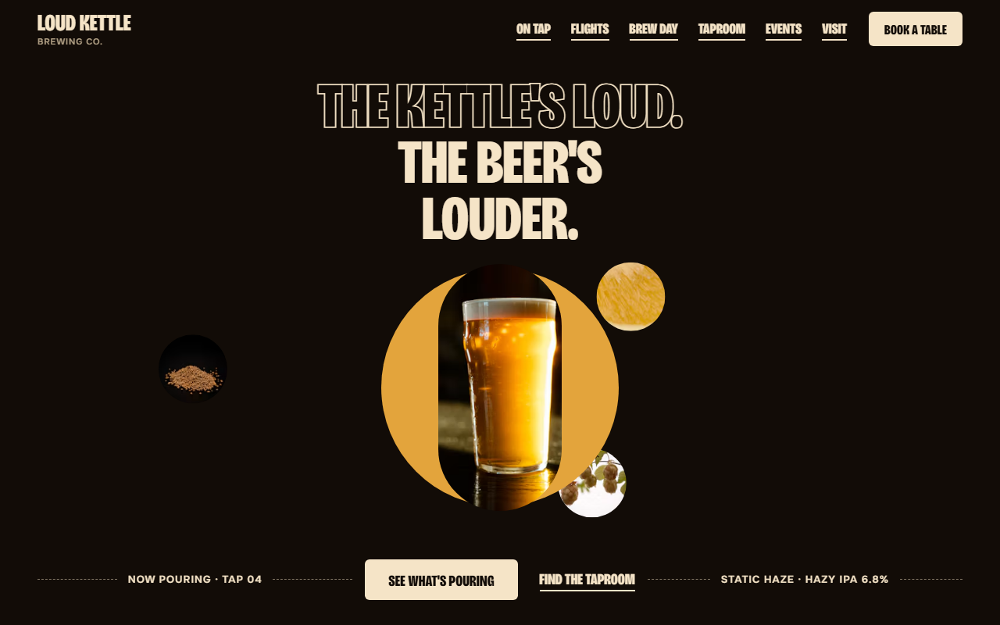
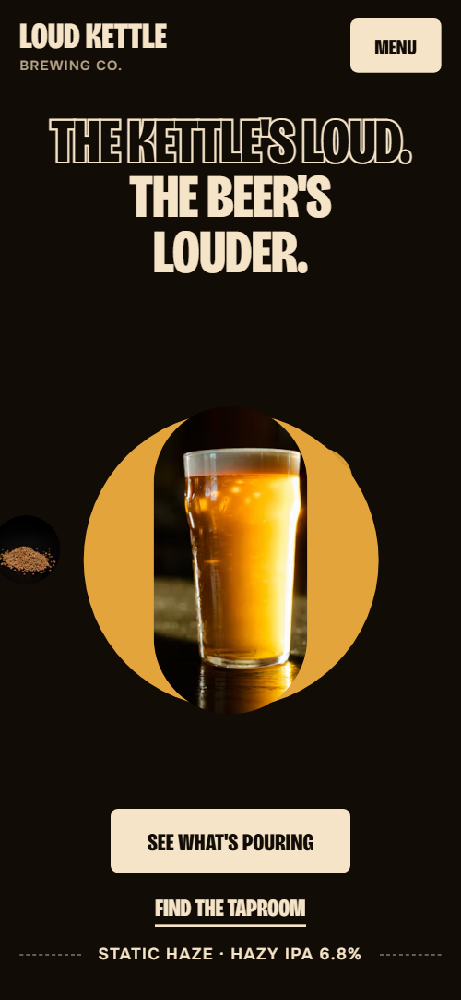
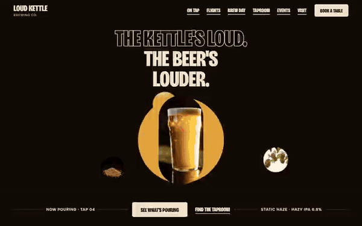

# Free HTML brewery website template with GSAP scroll animations

Brewery website template: a free one-page site for a craft brewery or taproom, with a five-beer tap list, a four-slot flight builder, a brew day on a turning wheel, dated events and a booking request form. The look is cream tags and condensed capitals on near-black, one colour per beer. It is one HTML file with an AGENTS.md, so Claude Code, Cursor or Codex can adapt it to your beers.

[](LICENSE)  

**[Live demo](https://8bsite.github.io/brewery-website-template/)** · **[Use this template](https://github.com/new?template_name=brewery-website-template&template_owner=8bsite)** · **[Download ZIP](https://github.com/8bsite/brewery-website-template/archive/refs/heads/main.zip)** · **[Template page on 8b.com](https://8b.com/templates/loud-kettle/)**

<a href="https://8bsite.github.io/brewery-website-template/"></a> <a href="https://8bsite.github.io/brewery-website-template/"></a>

<p align="center"><a href="https://8bsite.github.io/brewery-website-template/"></a><br><sub>Scroll animation</sub></p>

## Use it with Claude Code, Cursor or Codex

Download the four files into your project folder (`curl.exe` in Windows PowerShell):

```bash
curl -LO https://raw.githubusercontent.com/8bsite/brewery-website-template/main/index.html
curl -LO https://raw.githubusercontent.com/8bsite/brewery-website-template/main/AGENTS.md
curl -LO https://raw.githubusercontent.com/8bsite/brewery-website-template/main/LICENSE
curl -LO https://raw.githubusercontent.com/8bsite/brewery-website-template/main/CREDITS.md
```

Then fill in the angle brackets and give your agent this prompt:

```text
Read AGENTS.md, then edit index.html. Make it the site for <my brewery: name, city, address, beers with style, strength and prices, hours, dog, kids and food rules, dated events, how groups book, any cans or growler fills I sell>. Replace first the name, the five beers and their colours, the hours, which appear in two places, and the events. Keep the section ids and the classes AGENTS.md lists, and set each big display word's length number to its new character count. The beer grid and the brew day wheel are built for five items. Ask me for missing facts and never invent prices, hours, addresses, licences, reviews or contacts.
```

Vibe coders can hand this file to Claude Code, Cursor or Codex and let it start with the tap list: five beers, each with a style, a strength, pint and half prices and a colour. Name, city and address come next. The opening hours sit in two places, the taproom card and the hours list, and a beer name also appears in the hero label, the flight buttons, the events and the quotes, so search the whole file. Leave the section ids and the listed classes alone. Ask the owner for dog, kids and food rules, capacity, event dates and how groups book. Never invent licences, prices or quotes.

No agent? Click **[Use this template](https://github.com/new?template_name=brewery-website-template&template_owner=8bsite)**, edit `index.html` on GitHub and turn on **Settings > Pages**.

## Sections and motion

- **Navigation**: top bar: two-line wordmark, section links, Book a table button; phone menu overlay.
- **The kettle's loud. The beer's louder.**: two-screen hero: headline, product photo on a brand-colour disc with three orbiting photos, then a manifesto sentence on the brand colour (demo: a pint and ingredients). Smooth scrolling runs page-wide. Round photos orbit the pint on a loop; on scroll the amber disc floods the screen, the pint lifts away and photo chips pop into the text.
- **Four things that never go in the kettle**: column of four hanging tag-cards (principles or features) among floating round photos. Tied to scroll, the four tag-cards drop in turn and swing to rest while round photos float up at two speeds.
- **What's pouring**: giant outlined word over five product cards in a staircase, each in its own colour (demo: the beers on tap). On desktop the five cards step down the staircase as you scroll, each filling with colour like a poured glass.
- **Build a flight of four. $14**: interactive picker: choose four items into round slots, then save (demo: a beer flight). A tapped beer goes into the next empty round slot, which fills with its colour from the bottom; tap a slot to clear it.
- **From grain to glass**: five numbered process steps that turn on a big wheel as you scroll (demo: brew day from grain to glass). Pinned: the five numbered steps sit on a huge dashed wheel that turns one step at a time as you scroll.
- **The tram shed**: the venue: heading, lead, one wide and two small photos, three fact cards (demo: hours, dogs, food truck). The title rises line by line, and the three fact cards swing down on an elastic hinge as they arrive.
- **Overheard**: testimonials: giant outlined word and a slow scrolling row of six quotes on tag-cards. The outlined word's letters ripple in a wave that settles as it scrolls up; the quote cards below roll sideways, pausing on hover.
- **Ask the bar**: questions and answers (native &lt;details&gt;), sticky heading on desktop. The heading rises line by line on arrival and stays beside the questions on desktop as you read.
- **Loud nights**: list of dated events as ticket rows: date stub, title, text, price and time. Tied to scroll, the ticket rows start stacked and tilted on the first one and deal out into a list.
- **Come thirsty**: contact: photo of the venue, address, hours, phone and email cards, and a booking request form (placeholders). The Come thirsty heading rises line by line and the three fact cards swing down on their hinges.
- **Footer**: width-filling outlined wordmark, links, newsletter signup, social icons, copyright and the Design: 8B credit.

## Design

 near-black brown background  
 cream text, tags, buttons, date stubs  
 dark brown flight panel and stout card  
 amber hero disc, IPA card, button hover  
 orange pale ale card  
 red ale card  
 peach sour card  
 muted tan secondary text

**Bricolage Grotesque**: headings, tags, buttons: extra-bold, condensed, uppercase, some outlined. **Onest**: body and small tracked labels (Google Fonts). Cream tag labels with a punched hole at each end sit over hairline-bordered panels on a near-black ground. Photos are cut into circles and tall pills, giant outlined words fill the width, beer cards step down a staircase on wide screens, and events read as tickets.

## Questions

**Does the flight builder take orders or save anything?**  
No. Six beer buttons fill four round slots, and the Save button switches on once all four are full. Pressing it only writes a line on the page that lists the four beers for the guest to show at the bar; nothing is stored, sent or paid for. The six buttons are a separate list from the five tap cards, so edit both.

**Do the booking form and the newsletter signup send anything?**  
No. Both check their fields, show a thank-you or error line and send nothing. Connect Formspree or Netlify Forms, or remove the form together with its script and keep the email link. The thank-you line promises a call within a day, yet the booking form has no phone field, so add one or change the promise.

**Where do I change the beers and their colours?**  
The beers live in the five tap cards and six flight buttons, and the colours in the :root block. A card holds a name, a style and strength, a photo, a one line note and two prices, and takes --color-5, --color-4, --color-6, --color-7 or --color-3. The fifth card's flight swatch takes --color-1 instead, and --color-4 paints the hero disc too, so compare each card with its swatch after a recolour.

## Is it the right base?

This template is the right base when the brewery sells a place as much as a product: taps, house rules, a dated list of nights out and groups booking a room. A venue that earns mostly from its kitchen should start from the [restaurant](https://8b.com/templates/ombrelle/) template instead, which is organised around a menu and table booking. Where it falls short is everything after the click. There is no shop, cart, ticket checkout, table availability or age notice, and the Book a table buttons only scroll to the visit section of the same page, so a brewery website that sells or reserves online needs a service wired in.

## Before you publish

- Replace what is marked `data-8b-placeholder` (social preview image, favicon, map, phone, email, form, social) and the invented demo facts; [AGENTS.md](AGENTS.md) lists them.
- The form sends nothing yet: connect it to Formspree or Netlify Forms, or remove it.

## Tech

GSAP 3.13.0, ScrollTrigger, SplitText, Lenis 1.3.27 from jsDelivr, 96 KB, no build step. Chrome and Edge 111+, Safari 16.2+, Firefox 113+ (it uses color-mix(), cascade layers, small/dynamic viewport units). With "reduce motion" on, the page is complete and still.

## License

MIT, see [LICENSE](LICENSE). Photos, fonts and libraries keep their own licences: [CREDITS.md](CREDITS.md). More free templates: [8b.com/templates](https://8b.com/templates/) · [github.com/8bsite](https://github.com/8bsite).
